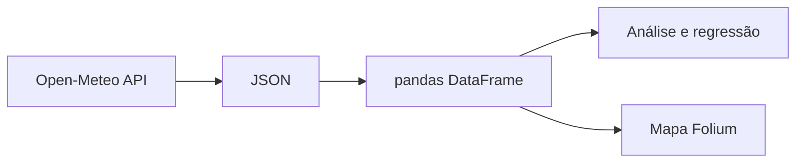

# Climate Studies

**Estudo exploratório de dados meteorológicos: da consulta de uma API à análise estatística e visualização geográfica.**

Python · pandas · scikit-learn · Matplotlib · Folium · Jupyter

## O que está implementado

| Arquivo | Conteúdo |
| :-- | :-- |
| `get_weather.py` | Consulta horária de velocidade do vento, com limite de espera e tratamento de erros HTTP/rede. |
| `main.ipynb` | Dados de São Paulo, gráficos de temperatura e umidade, correlação e regressão linear simples. |
| `plot_data_map.ipynb` | Dados de oito cidades mineiras e mapa de velocidade do vento às 12h. |



## Executar localmente

Use Python 3.11 ou 3.12. Em Linux/WSL:

```bash
git clone https://github.com/Joao-Paulo-de-Oliveira/climate_studies.git
cd climate_studies
python3 -m venv .venv
source .venv/bin/activate
python -m pip install -r requirements.txt
python -m jupyterlab
```

Abra um notebook e execute as células em ordem. As consultas exigem internet; datas e coordenadas estão nas células iniciais. Para o mapa, execute até a exibição de `folium_map`.

## Dados e limitações

O código usa o endpoint de **previsões históricas** da [Open-Meteo](https://open-meteo.com/en/docs/historical-forecast-api), e não observações de estações. Consulte a documentação para cobertura, unidades e condições de uso. O código não informa `timezone`: confira o fuso na resposta antes de interpretar 12h como horário local.

A regressão usa um único dia e é ajustada e visualizada nos mesmos dados. Ela demonstra o método, mas **não comprova capacidade de previsão**, generalização ou relação causal. Não há avaliação em conjunto de teste.

O coletor retorna `None` em falhas HTTP/rede. Os notebooks ainda assumem resposta válida: interrompa a execução se a consulta falhar. O limite de espera de 30 segundos se aplica ao coletor; a consulta direta do notebook principal ainda precisa desse tratamento.

## Verificações do coletor

```bash
python -m unittest discover -s tests -v
```

Os testes simulam a API e não fazem requisições externas.

## Próximas melhorias

- Persistir dados brutos e tratados com metadados da consulta.
- Validar campos, unidades, valores ausentes e intervalos de tempo.
- Centralizar a coleta e tratar falhas nos notebooks.
- Avaliar modelos com divisão temporal e uma referência simples.
- Separar escalas de temperatura e umidade nos gráficos.
